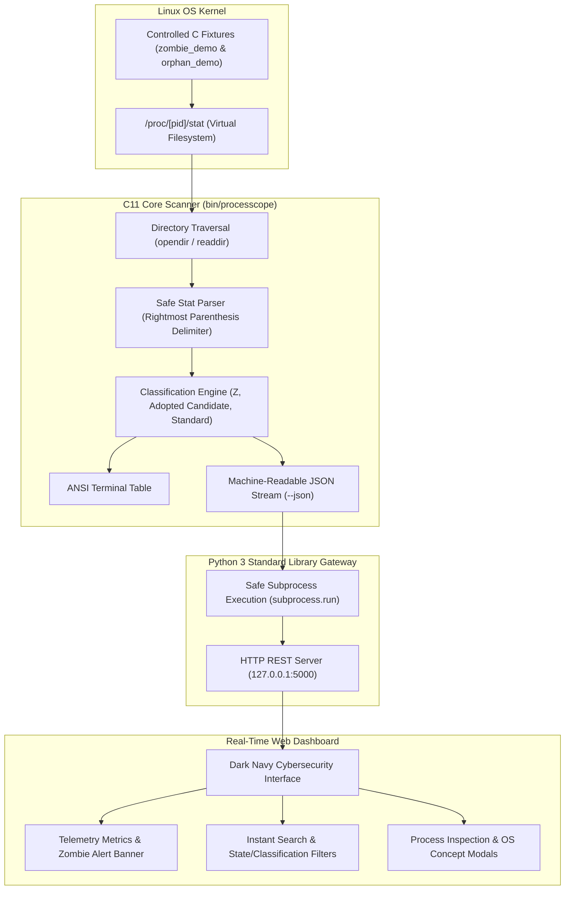

# ProcessScope: 10-Slide Presentation Deck Outline

**Course:** Operating Systems and Systems Programming  
**Target Audience:** OS Faculty Evaluators, Hackathon Judges, and B.Tech Peer Students

---

## Slide 1: Title & Project Identity

- **Slide Title:** ProcessScope — Zombie and Orphan Process Detection System
- **Subtitle:** An Authoritative Linux Systems Programming & Observability Framework
- **Category:** Operating Systems & Systems Programming
- **Presenter / Team:** [Student Name / Roll Number / Team Name]
- **Key Visual Elements:**
  - Linux Kernel Logo / Terminal Icon
  - Project Tagline: *"Bridging low-level Linux kernel primitives with real-time systems observability."*

---

## Slide 2: Problem Statement

- **Slide Title:** The Problem: Silent Process Leaks & Misleading Tools
- **Bullet Points:**
  - **Zombie Processes (`Z` / Defunct):** When a child process terminates, its Process Control Block (PCB) remains in the kernel until the parent acknowledges it with `wait()` / `waitpid()`. Un-reaped zombies accumulate and exhaust the kernel's finite PID space (`/proc/sys/kernel/pid_max`).
  - **Orphan Processes:** When a parent dies before its child, the surviving child is left parentless and must be reparented by the kernel.
  - **The Tooling Gap:** Traditional utilities like `ps` and `top` do not alert on zombies or explain parent-child anomalies.
  - **Educational Flaw:** Many scripts incorrectly claim that *all* processes with PPID 1 are orphans.
- **Presenter Script:**
  > *"Every operating systems student learns about zombies and orphans, but seeing them in action on a real Linux kernel is rarely demonstrated safely. Furthermore, standard tools don't clearly distinguish legitimate daemons from orphaned processes. ProcessScope solves this."*

---

## Slide 3: Project Objectives

- **Slide Title:** Project Objectives & Scope
- **Bullet Points:**
  - **C11 Process Engine:** Build a high-performance C scanner that reads directly from the Linux `/proc` virtual filesystem.
  - **Resilient Parsing:** Parse `/proc/[pid]/stat` correctly even when process names contain spaces or nested parentheses.
  - **Honest Classification:** Distinguish confirmed zombies (State `Z`) from heuristic candidates (`adopted_candidate` for PPID 1) and standard processes.
  - **Controlled Safe Fixtures:** Provide standalone C demonstration programs to recreate and resolve zombies and orphans on demand.
  - **Modern Cyber Dashboard:** Deliver an auto-refreshing dark-navy web UI with zero external runtime dependencies.

---

## Slide 4: Existing System vs. Proposed Solution

- **Slide Title:** Existing Limitations vs. ProcessScope Architecture

| Aspect | Conventional Tools (`ps`, `top`) | ProcessScope Solution |
| :--- | :--- | :--- |
| **Parsing Safety** | Prone to naive token splitting | Robust rightmost parenthesis delimiter |
| **Zombie Alerting** | Passive text line | Real-time visual alert banner + metric card |
| **Orphan Semantics** | Falsely assumes PPID 1 = Orphan | Uses `adopted_candidate` + controlled demo verification |
| **Demonstration** | Manual risky scripts | Self-reaping, bounded C test fixtures |
| **User Interface** | Terminal dump only | Unified Terminal Table + Real-time Web Dashboard |

---

## Slide 5: System Architecture

- **Slide Title:** System Architecture & Data Flow
- **Mermaid Diagram:**

---

## Slide 6: C Core Engine & Linux Process Concepts

- **Slide Title:** C Implementation & Linux `/proc` Engineering
- **Bullet Points:**
  - **The Linux `/proc` VFS:** Each active PID is represented as a directory `/proc/[pid]/`.
  - **Handling Tricky Process Names:**
    - Line format: `1234 (worker (gpu) thread) S 5678 ...`
    - Finding the *first* `(` and the *last* `)` using `strchr` and `strrchr` guarantees the full `comm` string is captured regardless of internal spaces or parentheses.
  - **State Interpretation:**
    - `Z` = Zombie / Defunct (Terminated, awaiting parent `wait()`)
    - `S` = Sleeping (Waiting for event/signal)
    - `R` = Running / Runnable
    - `D` = Uninterruptible Disk Sleep
  - **Error Resilience:** Handles processes terminating mid-scan (`ENOENT`) or unreadable entries (`EACCES`) cleanly.

---

## Slide 7: Web Dashboard & Local Backend API

- **Slide Title:** Dashboard UI & Secure Local API
- **Bullet Points:**
  - **Zero Third-Party Dependencies:** Backend runs entirely on Python 3's built-in `http.server` module—no `pip install`, Flask, or Node.js required.
  - **Security by Design:**
    - Binds strictly to `127.0.0.1` (localhost).
    - Executes `./bin/processcope --json` directly without invoking a shell.
    - Read-only process inspection; no dangerous kill or modifying endpoints.
  - **Frontend Aesthetics:**
    - Dark navy systems-engineering aesthetic (`#080c15`).
    - Color-coded badges: Red for Zombies, Amber for Adopted Candidates, Green for Running.
    - 3-second auto-polling with manual override and live status indicator.

---

## Slide 8: Testing Scenarios & Validation Results

- **Slide Title:** Comprehensive Testing & Verification Results
- **Bullet Points:**
  - **35 of 35 Automated Tests Passed (100%):**
    - Unit parser tests: 28 assertions passed (names with spaces, nested parentheses, JSON escaping).
    - JSON schema validation: Verified against Python's strict JSON parser.
    - Live zombie lifecycle test: Confirmed detection of `Z` state and verified removal after `waitpid()`.
    - Live orphan reparenting test: Confirmed child reparented to PID 1 / subreaper.
    - REST API tests: Confirmed HTTP 200 responses on `/api/health` and `/api/processes`.
  - **Zero Compiler Warnings:** Clean compilation using `gcc -std=c11 -Wall -Wextra -Wpedantic -O2`.

---

## Slide 9: Live Demonstration & Safety Architecture

- **Slide Title:** Live Demonstrations: Zombie & Orphan Workflows
- **Controlled Zombie Demo (`bin/zombie_demo`):**
  1. Parent forks child; child calls `exit(42)`.
  2. Parent pauses without `wait()`.
  3. Evaluator observes the zombie in Terminal or Dashboard (State `Z` alert).
  4. User presses `<Enter>`; parent calls `waitpid()` and successfully dissolves the zombie.
- **Controlled Orphan Demo (`bin/orphan_demo`):**
  1. Parent creates child and terminates immediately.
  2. Child calls `getppid()`, proving kernel reparented it to PID 1 (or subreaper).
  3. Child auto-terminates after a bounded window (10s) ensuring zero lingering tasks.
- **Safety First:** Both programs feature automatic safety timeouts to prevent orphaned background tasks.

---

## Slide 10: Conclusion & Future Scope

- **Slide Title:** Summary & Future Directions
- **Key Takeaways:**
  - ProcessScope provides an authoritative, robust, and safe tool for Linux process relationship monitoring.
  - Demonstrates core OS concepts (fork, exit, waitpid, reparenting, PCB retention) with absolute clarity.
  - Eliminates common false assumptions regarding orphan detection.
- **Future Scope:**
  - Real-time continuous kernel event streaming via **eBPF** tracepoints (`sched_process_exit`).
  - Interactive SVG visual process hierarchy tree.
  - Cross-platform support for FreeBSD and macOS procfs abstractions.
- **Thank You / Q&A:** Questions from the faculty evaluation panel.
